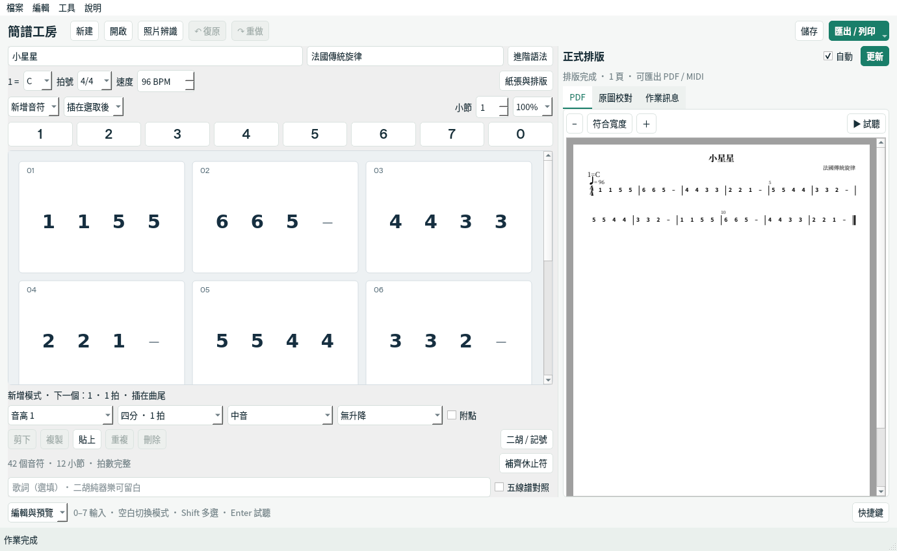

# 簡譜工房 Jianpu Studio

**Windows 上的繁體中文簡譜編輯器。用滑鼠或數字鍵寫譜，預覽、試聽，再印出來。**

適合二胡等單旋律樂譜的基本製作。整合 LilyPond、jianpu-ly 與 Audiveris，安裝後可離線使用。

## 下載與安裝

**[下載 Windows 安裝程式](https://github.com/miles990/jianpu-studio/releases/latest)** → 選擇 `JianpuStudio-0.1.3-Windows-x64-Setup.exe`。

1. 開啟安裝檔，選「為所有使用者安裝」，同意 Windows 管理員授權。
2. 選擇安裝資料夾，例如 `D:\音樂工具\簡譜工房`，按「安裝」。
3. 從桌面開啟「簡譜工房」，先用內建「小星星」試試看。

**所有環境一次裝好**，不用另外安裝 Python、Java、排譜或辨識工具。支援中文及含空白的安裝路徑。只安裝到自己的資料夾時，也可選「僅為我安裝」。

適用 **Windows 10 1903 以上／Windows 11，64 位元 x64**。建議 8 GB RAM、2 GB 可用空間；照片辨識建議 16 GB RAM。下載頁也有免安裝 ZIP，請完整解壓縮後開啟 `JianpuStudio.exe`。

目前安裝檔尚無程式碼簽章，Windows 可能顯示未知發行者。請從本專案 Release 下載，並可用 `SHA256SUMS.txt` 核對檔案。

## 已安裝舊版，要怎麼更新？

先儲存樂譜並關閉程式，再執行新版安裝檔，選擇與舊版相同的安裝模式和資料夾。**不用先解除安裝**；自己的 `.jps` 樂譜與使用者設定會保留。

**從 0.1.3 起**，可在程式中選「說明 → 檢查更新」，按「下載更新」，完成校驗後按「關閉並更新」。若有未儲存樂譜會先詢問，更新後重新開啟，保留原安裝位置、設定與樂譜。Program Files 可能需要管理員授權。

0.1.2 或更早版本需先用安裝檔升級一次。免安裝版可檢查新版，仍需從下載頁完整下載解壓縮；程式內套用更新目前支援安裝版。

## 開始寫譜

1. 按「新建樂譜」，填曲名、調號、拍號與速度。
2. 點 `1–7` 加入音符，`0` 加入休止符；點選音符區後也能用數字鍵輸入。
3. 點選音符，調整時值、八度、升降或附點，再按「套用到選取音符」。
4. 用「複製、刪除、移前、移後」整理音符；不足一小節時可「補齊休止符」。
5. 按 `Ctrl+S` 儲存 `.jps`，下次可繼續修改。

目前加入的音符會插在選取音符後面。`Ctrl+Z` 復原、`Ctrl+Y` 重做、`Delete` 刪除選取音符。

用過 EOP 的使用者可以直接使用數字鍵 0–7；目前版本的其他快捷鍵與檔案格式並未完全相容，不能直接開啟 EOPN。

## 預覽、試聽與列印

- 右側顯示實際 PDF 排版，可縮放與閱讀多頁樂譜。
- 按「更新排版」或 `F5` 更新，完成後可試聽、匯出 PDF 或 MIDI。
- 「開啟／列印」會用 Windows 的 PDF 閱讀器開啟。
- 視窗較小時，左側導覽會收起；編輯區可捲動，主要功能也能從上方選單使用。

## 照片轉簡譜

1. 按「照片轉簡譜」，選擇**印刷五線譜**照片。
2. 調整角度、白邊與對比，保留完整五線譜，再開始辨識。
3. 若引擎判定譜線間距太小，程式會自動計算放大倍率，重試一次。
4. 對照「照片原圖」檢查音高、調號與節奏，再儲存專案。

放大能協助引擎處理小圖，**無法補回遺失的細節**。原始高畫質圖片或 300 DPI 掃描通常更適合辨識。混有和弦圖、數字簡譜與歌詞的圖片可能需要更多人工校對。

辨識失敗會顯示中文原因；在「排版／辨識訊息」按「複製完整紀錄」，可附到 [問題回報](https://github.com/miles990/jianpu-studio/issues)。

## 目前支援到哪裡？

| 項目 | 目前支援 |
| --- | --- |
| 滑鼠編輯 | 單旋律音符、休止、時值、八度、升降、附點、歌詞 |
| 檔案 | `.jps` 專案、MusicXML 匯入、PDF／MIDI／簡譜文字匯出 |
| 照片 | 印刷五線譜轉簡譜；不支援手寫譜或數字簡譜圖片，中文歌詞需手動輸入 |
| 特殊記號 | 連線、反覆、倚音、三連音、多聲部等可用進階 jianpu-ly 語法；部分原始 LilyPond 功能受限 |
| 二胡 | 可製作基本單旋律簡譜；指法、弓法等圖形化工具尚未在 0.1.3 發布 |

進階原始碼不能自動轉回視覺音符；切換前請閱讀程式提示。複雜 MusicXML 可能進入進階模式。重要樂譜請保留備份，辨識結果請人工校對。

更多操作見 [完整手冊](docs/user-guide.md)。開發、測試與技術細節見 [開發文件](docs/development.md)。

## 開源與授權

本程式為 MIT 授權，為獨立專案。[LilyPond](https://github.com/lilypond/lilypond)、[jianpu-ly](https://github.com/ssb22/jianpu-ly)、[Audiveris](https://github.com/Audiveris/audiveris) 等元件保留各自授權，詳見 [第三方授權與來源](THIRD_PARTY_NOTICES.md)。
