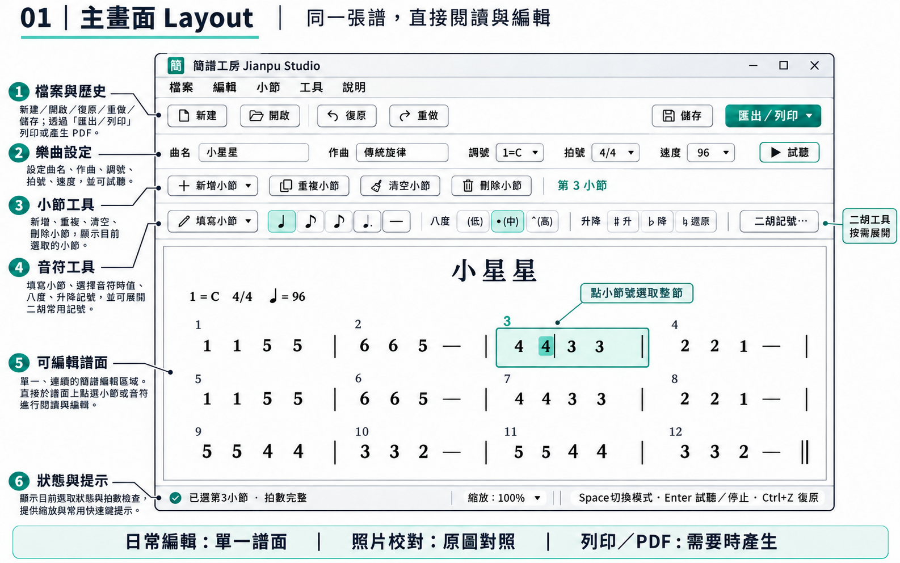
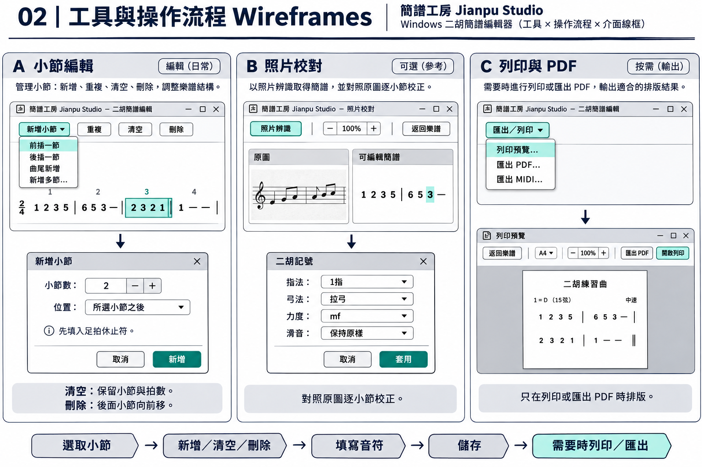

# 同譜面閱讀與編輯：Layout / Wireframes

2026-11-12 繪製的設計概念圖，說明 0.3.0 的工作區構想。圖中的控件外觀及樂譜為示意；圖內照片／原圖對照流程是先前構想，依最新需求已從本版介面移除，不代表可用功能；實際操作名稱、快捷鍵與限制以[使用手冊](../user-guide.md)為準。

- 日常在同一張可編輯簡譜上閱讀、點選音符與操作小節。
- 曲名、作曲者、調號、拍號、速度放在預設收起、可展開的「樂曲設定」，讓小螢幕初始也能看到音符。
- 「清空小節」保留時間；「刪除小節」讓後段前移；「填寫小節」用音符取代休止，不推動後段。
- 本版暫移除照片辨識與原圖對照入口，專注寫譜。正式 PDF 只在列印／PDF 匯出時產生；試聽使用獨立 MIDI。
- 「記號 / 二胡」整理單音記號與範圍記號；三連音採一音拆三份、總拍數不變，倚音附在主音設定。

研究來源與取捨見[競品研究](../uiux-research.md)。0.2.1 已有力度、連弓／圓滑線與延音線；0.3.0 增加三連音、漸強弱與倚音等視覺操作。記號支援及限制見[手冊](../user-guide.md)，不以示意圖推定完整功能。
